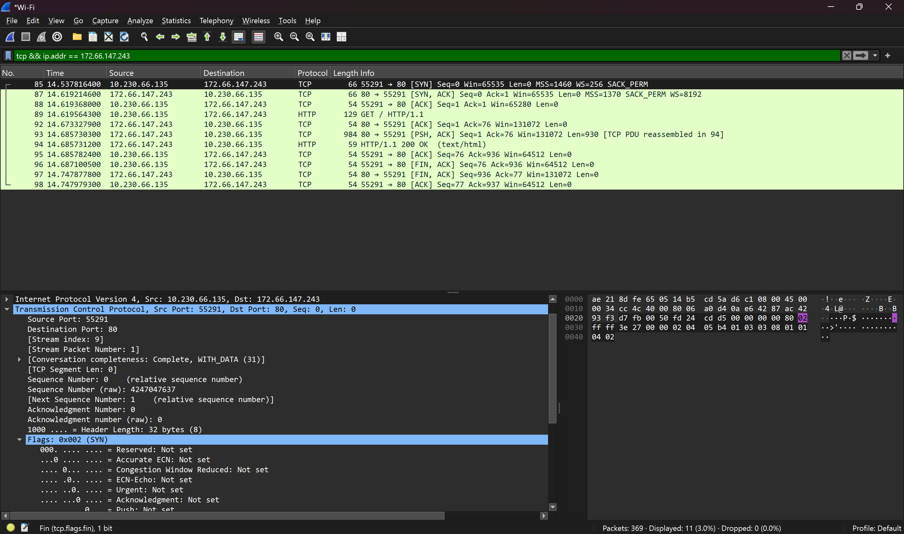
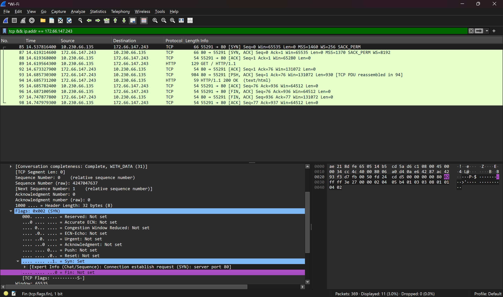
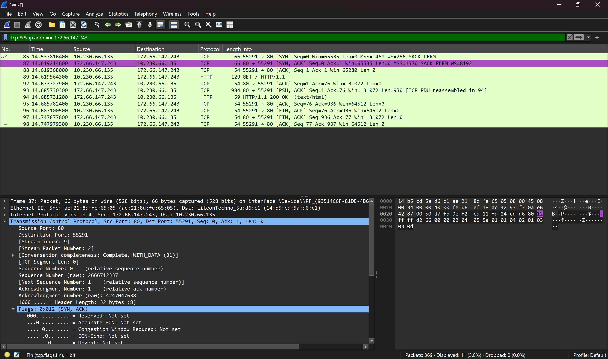
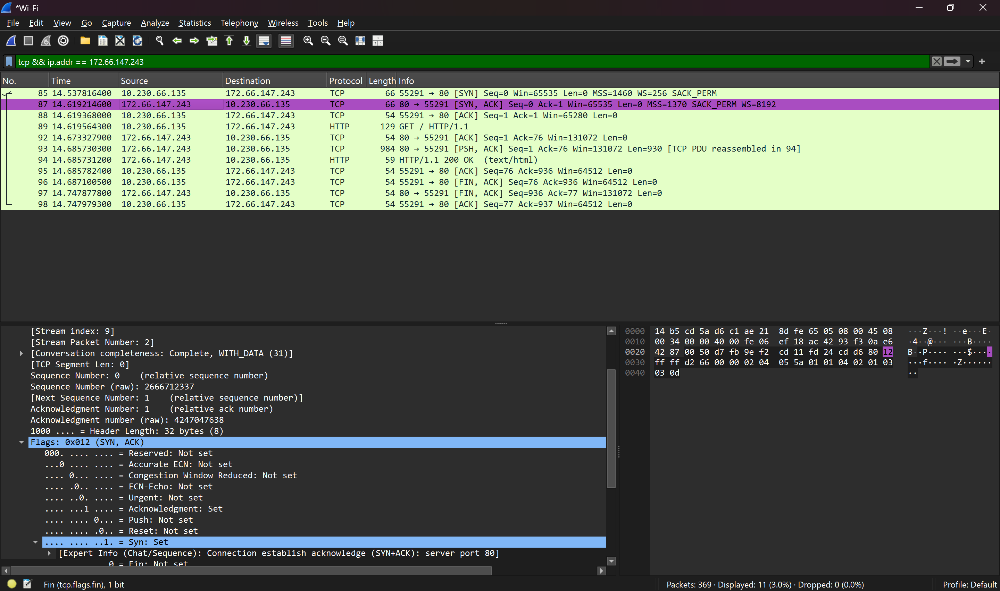
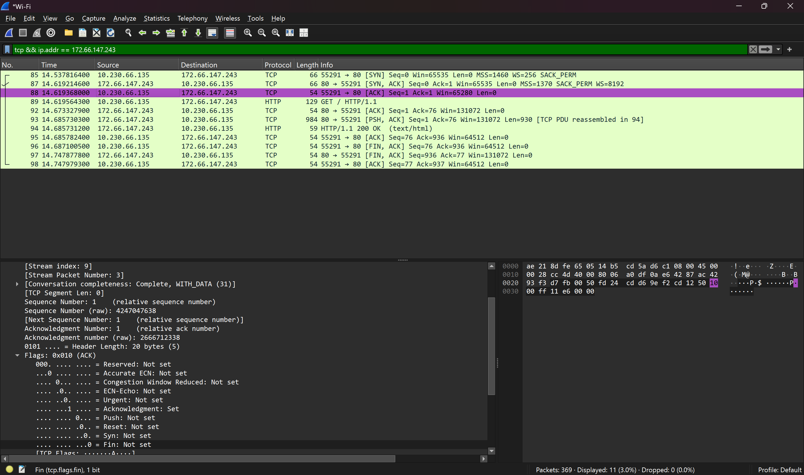

# Three-Way Handshake
**Date:** 18 October 2026
**Week:** 2, Day 6

## What I understood

**three-way handshake:-**
when two devices want to communicate through tcp,they first establish connection through three-way handshake.

It has three steps.

SYN- our device sends a synchronize (SYN) Segments to the server saying "i want to communicate."

SYN-ACK- server replies with "i am ready, Are you ready?"

ACK-our device replies " yes i am ready,lets communicate"

after these three steps we establish connection and we are ready for data to flow.

**why it is matters in soc work?**

A SYN scan may send SYN packets to many ports without completing the handshake. 
This can be a sign of port scanning, so SOC analysts investigate the pattern along with other evidence.

## What confused me

when i open the wireshark and the packets start flowing i did not know what the hell is going, later i understand it and then i run the command 
and stop the data flowing and then i filter out the specific packets.so i can study actual three-way handshake.
also i am confused by seeing a lot of information but then i started to understood it.

## Lab output

i opened wireshark, selected my wifi interface and started to capture. after that i ran curl http://example.com in cmd.
i stop the capture and then filter it out with the server ip.
i found,
packet 85 which is SYN packet in that my laptop is sending request for communication to 172.66.147.243 on the port 80 and only syn flag is set.
packet 87 which is SYN-ACK packet in this the server is replying and the SYN-ACK flags are set here.
packet 88 which is ACK packet in this my laptop replies and confirm it for communication and here only ack flag is set and then the handshake done.

i also saw the full http conversation after that including get request and 200 ok response and then the fin packets closing the connection.

## One thing I can now explain without notes

A three-way handshake is the process when two devices want to communicate through TCP(Transmission Control Protocol),
they need to establish the connection first through three way handshake it has three steps; that's why it is known as three way handshake.

the three steps are:-

SYN-our device sends a synchronize packet to the server by saying i want to communicate.

SYN-ACK-server receives it and then it replies with i received your request, i am ready to communicate are you ready to communicate.

ACK-our device received the server message and it replies to the server with yes i am ready to communicate lets communicate.

after these three steps we are ready for communication because the connection is established and data starts flowing.

## Wireshark Screenshots

### 1. SYN packet — Part 1

### 2. SYN packet — Part 2

### 3. SYN-ACK packet — Part 1

### 4. SYN-ACK packet — Part 2

### 5. ACK packet

## What I'll review tomorrow

Tomorrow is Day 7 - review day. I will speak everything 
from this week aloud for 3 minutes without notes and 
record it.
